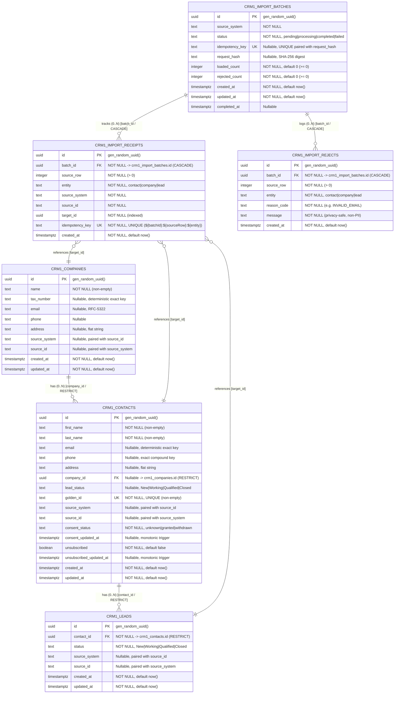

# ClearShift CRM — Entity-Relationship Diagram & Master-Data Ownership: CRM-1

**Module ID:** `CRM-1`
**Module Name:** Contacts, Companies and Leads (Master Data Domain)
**Owning Team:** Team `crm-contacts` (Group 1)
**Schema Version:** 1.0.0
**Storage Engine:** PostgreSQL 18.6 with Drizzle ORM
**Target Milestone:** Gate G1 — Design Complete (Sprint 1)
**Traceability:** ClearShift Project Plan v3.0 §§9.3–9.6, 17; SDS ClearShift CRM v2.0 §4.2, §4.7; Master Architecture Baseline 1.0-A §4.2; Issue `[CRM1-24]`.

---

## 1. Visual Entity-Relationship Diagram (Mermaid)



---

## 2. ASCII Architecture & Topology Overview

```
 ┌────────────────────────────────────────────────────────────────────────┐
 │                      CRM-1 DOMAIN STORAGE BOUNDARY                     │
 │                             (PostgreSQL Schema: crm1)                  │
 │                                                                        │
 │   ┌────────────────────────┐                   ┌───────────────────┐  │
 │   │    crm1_companies      │                   │ crm1_import_      │  │
 │   │  (Flat Master Entity)  │                   │ batches           │  │
 │   └───────────┬────────────┘                   └─────────┬─────────┘  │
 │               │ 1                                        │ 1          │
 │               │                                          │            │
 │               │ 0..N (RESTRICT)                          │            │
 │               ▼                                          │            │
 │   ┌────────────────────────┐                             │            │
 │   │    crm1_contacts       │◀────────────┐               │            │
 │   │  (Golden Identity)     │             │               │            │
 │   └───────────┬────────────┘             │               │            │
 │               │ 1                        │               │            │
 │               │                          │               │            │
 │               │ 0..N (RESTRICT)          │               │            │
 │               ▼                          │               │            │
 │   ┌────────────────────────┐             │               │            │
 │   │     crm1_leads         │             │               │            │
 │   │  (Sales Prospects)     │             │               │            │
 │   └────────────────────────┘             │               │            │
 │                                          │               │            │
 │               ┌──────────────────────────┴────────┐      │            │
 │               │      crm1_import_receipts         │◀─────┤ 0..N       │
 │               │ (Atomic Idempotency Receipts)     │      │ (CASCADE)  │
 │               └───────────────────────────────────┘      │            │
 │                                                          │            │
 │               ┌───────────────────────────────────┐      │            │
 │               │      crm1_import_rejects          │◀─────┘ 0..N       │
 │               │    (Non-PII Row Failure Audit)    │        (CASCADE)  │
 │               └───────────────────────────────────┘                   │
 └────────────────────────────────────────────────────────────────────────┘
```

---

## 3. Entity Cardinality & Foreign Key Reference Matrix

| Relationship ID | From Entity & Column | To Entity & Column | Cardinality | Database Constraint | On Delete Action | Business Rule & Invariant |
| :--- | :--- | :--- | :---: | :--- | :---: | :--- |
| `REL-CRM1-01` | `crm1_contacts.company_id` | `crm1_companies.id` | N : 1 | `FOREIGN KEY (company_id) REFERENCES crm1_companies(id)` | **RESTRICT** | A contact optionally belongs to a single company. Deletion of a company is strictly blocked when linked contacts exist. |
| `REL-CRM1-02` | `crm1_leads.contact_id` | `crm1_contacts.id` | N : 1 | `FOREIGN KEY (contact_id) REFERENCES crm1_contacts(id)` | **RESTRICT** | Every lead must be associated with an existing master contact. Orphan leads are prohibited. |
| `REL-CRM1-03` | `crm1_import_receipts.batch_id` | `crm1_import_batches.id` | N : 1 | `FOREIGN KEY (batch_id) REFERENCES crm1_import_batches(id)` | **CASCADE** | Per-row import receipts belong to an import batch and are purged if the parent batch record is cleaned up. |
| `REL-CRM1-04` | `crm1_import_rejects.batch_id` | `crm1_import_batches.id` | N : 1 | `FOREIGN KEY (batch_id) REFERENCES crm1_import_batches(id)` | **CASCADE** | Row failure audit records belong to an import batch and cascade on batch removal. |
| `REL-CRM1-05` | `crm1_import_receipts.target_id` | `crm1_contacts/companies/leads.id` | N : 1 | Application Guard & Index `idx_target_id` | **RESTRICT** | Polymorphic reference to target record; verified within transaction. |

---

## 4. Key Constraints, Idempotency & Search Indexes

### 4.1 Primary Keys
* All 6 tables use surrogate UUID primary keys generated by `gen_random_uuid()`:
  * `crm1_companies.id`
  * `crm1_contacts.id`
  * `crm1_leads.id`
  * `crm1_import_batches.id`
  * `crm1_import_receipts.id`
  * `crm1_import_rejects.id`

### 4.2 Unique Keys & Idempotency Guarantees
1. **Golden ID Uniqueness:** `crm1_contacts_golden_id_key` ON `crm1_contacts(golden_id)` (UNIQUE). Enforces single master record per Golden ID.
2. **Source System Provenance Uniqueness:**
   * `crm1_companies_source_key` ON `crm1_companies(source_system, source_id)` (UNIQUE)
   * `crm1_contacts_source_key` ON `crm1_contacts(source_system, source_id)` (UNIQUE)
   * `crm1_leads_source_key` ON `crm1_leads(source_system, source_id)` (UNIQUE)
   Re-importing rows from the same source system with identical source IDs is guaranteed idempotent.
3. **Batch Idempotency:** `crm1_import_batches_idempotency_key` ON `crm1_import_batches(idempotency_key)` (UNIQUE).
4. **Row-Level Import Idempotency:**
   * `crm1_import_receipts_idempotency_key` ON `crm1_import_receipts(idempotency_key)` (UNIQUE).
   * `crm1_import_receipts_batch_row_entity_key` ON `crm1_import_receipts(batch_id, source_row, entity)` (UNIQUE).

### 4.3 Search & Performance Indexes
* `crm1_contacts_name_search_idx`: Functional B-Tree index on `(lower(first_name), lower(last_name))` for case-insensitive contact lookup.
* `crm1_contacts_email_search_idx`: Functional B-Tree index on `(lower(email))` for case-insensitive duplicate and search queries.
* `crm1_contacts_company_id_idx`: Index on `company_id` to optimize join performance and foreign key checks.
* `crm1_companies_name_search_idx`: Functional B-Tree index on `(lower(name))` for company lookup.
* `crm1_leads_contact_id_idx`: Index on `contact_id` for quick lead retrieval per contact.
* `crm1_leads_status_idx`: Index on `status` for pipeline filtering.

---

## 5. Master-Data Ownership Boundaries (PLT-03 & SDS §4.2)

In strict compliance with ClearShift Architecture Rules:
1. **Module Domain Ownership:** CRM-1 owns all tables in the `crm1` PostgreSQL schema (`crm1_companies`, `crm1_contacts`, `crm1_leads`, `crm1_import_batches`, `crm1_import_receipts`, `crm1_import_rejects`). No other module or tool is permitted direct DDL/DML access.
2. **Zero Direct Cross-Module Writes:** Neither CRM-1 nor other modules may issue SQL `INSERT`, `UPDATE`, or `DELETE` statements across schema boundaries. Cross-module data integration occurs exclusively through authenticated APIs and asynchronous outbox events.
3. **Zero Cross-Schema Foreign Keys:** Tables in `crm1` declare foreign keys only to other `crm1` tables. References to other modules (such as ERP-3 customer links or CRM-4 marketing lists) are preserved as stable identifiers resolved via owning module APIs.
4. **Upstream Migration Ingestion:** The Migration Kit does NOT mutate CRM-1 tables directly. Target rows are ingested via `/api/v1/crm-contacts/imports` or the in-process `TargetAdapter`, where target records and import receipts commit atomically in a single PostgreSQL transaction.
5. **Downstream Cross-Module Consumers:**
   * **CRM-2 (Deals & Quotes):** Reads contacts and companies via public read APIs and projections (`contactName`, `companyName`); subscribes to `crm.contact.*` events.
   * **CRM-3 (Support Tickets):** Resolves customer contact identity via CRM-1 API.
   * **CRM-4 (Marketing Lists & Consent):** Synchronizes consent and unsubscribe state via `crm.contact.consent_changed` events.
   * **ERP-3 (Sales Orders):** Validates and references customer billing companies and contacts via public CRM-1 APIs.

---

## 6. Gate G1 Architecture Sign-Off

| Review Role | Representative | Signature Status | Review Date |
| :--- | :--- | :---: | :---: |
| **Group 1 Role 1** (Team Lead & Core Backend) | Aryaa Bhadane | **APPROVED** | 2026-10-23 |
| **Group 1 Role 4** (Data Reliability & QA Lead) | Data / QA Lead | **APPROVED** | 2026-10-23 |
| **Group 5 Peer Review** (CRM-5 Migration Control) | Peer QA Reviewer | **APPROVED** | 2026-10-23 |
| **Workstream 12 PMO** (Architecture Baseline) | PMO Lead | **VERIFIED** | 2026-10-23 |
