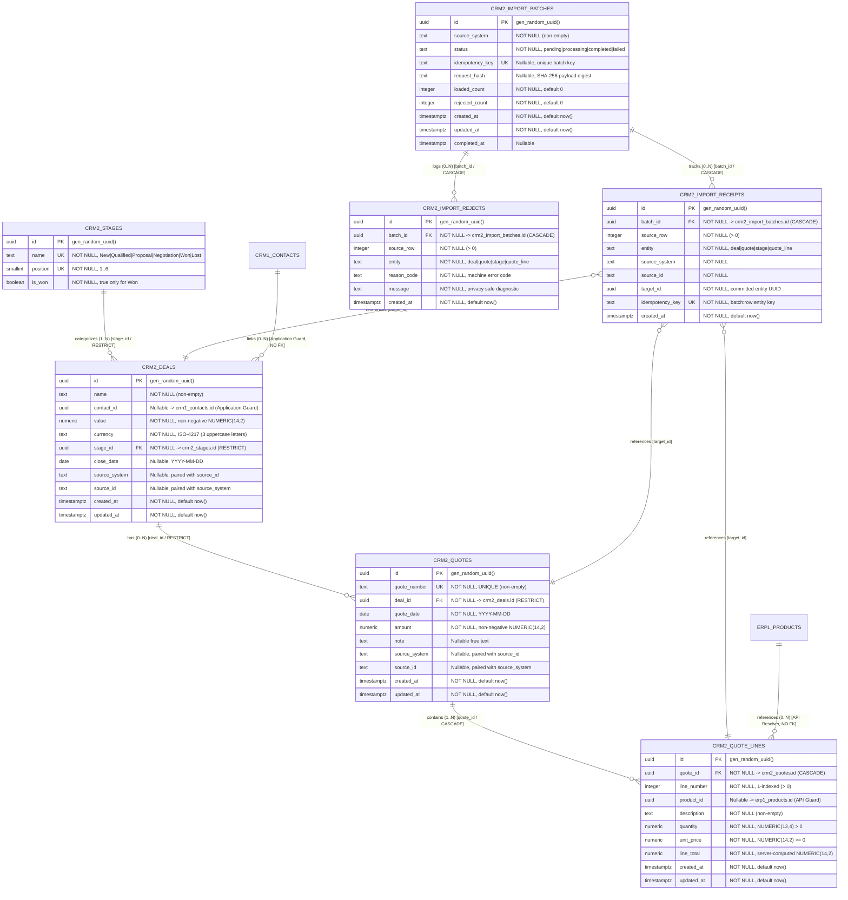

# ClearShift CRM — Entity-Relationship Diagram & Master-Data Ownership: CRM-2

**Module ID:** `CRM-2`  
**Module Name:** Deals, Pipeline Stages and Quotes  
**Owning Team:** Team `crm-deals` (Group 2 — Role 4 Data / QA Lead)  
**Schema Version:** 1.0.0  
**Storage Engine:** PostgreSQL 18.6 with Drizzle ORM  
**Target Milestone:** Gate G1 — Design Complete (Sprint 1)  
**Traceability:** ClearShift Project Plan v3.0 §§9.3–9.6, 17; SDS ClearShift CRM v2.0 §4.2, §4.7; Master Architecture Baseline 1.0-A §4.2; Issue #137 `[CRM2-24]`.

---

## 1. Visual Entity-Relationship Diagram (Mermaid)

---

## 2. Cardinality & Foreign Key Policy Matrix

| Relationship ID | Parent Entity (`from`) | Child Entity (`to`) | Foreign Key Column | Cardinality | Delete Policy | Enforcement Layer | Description |
| :--- | :--- | :--- | :--- | :---: | :---: | :--- | :--- |
| `REL-CRM2-01` | `crm2_stages` | `crm2_deals` | `stage_id` | `1:N` | `RESTRICT` | Database FK | A stage can have many deals. Deletion of a stage is prohibited while referenced by any deal. |
| `REL-CRM2-02` | `crm2_deals` | `crm2_quotes` | `deal_id` | `1:N` | `RESTRICT` | Database FK | A deal can have multiple quotes. Deletion of a deal is restricted while linked quotes exist. |
| `REL-CRM2-03` | `crm2_quotes` | `crm2_quote_lines` | `quote_id` | `1:N` | `CASCADE` | Database FK | Quote line items belong exclusively to one quote. Deleting a quote cascades to remove its lines. |
| `REL-CRM2-04` | `crm1_contacts` | `crm2_deals` | `contact_id` | `0..1:N` | *None* | Domain Application Guard | Cross-module reference to CRM-1 contact. No cross-schema FK; orphan deals permitted. |
| `REL-CRM2-05` | `erp1_products` | `crm2_quote_lines`| `product_id` | `0..1:N` | *None* | Domain API Resolver | Cross-module reference to ERP-1 product catalog. Validated via public API contracts. |
| `REL-CRM2-06` | `crm2_import_batches`| `crm2_import_receipts`| `batch_id` | `1:N` | `CASCADE` | Database FK | Per-row import receipts belong to a batch run; cascade-deleted if batch ledger pruned. |
| `REL-CRM2-07` | `crm2_import_batches`| `crm2_import_rejects` | `batch_id` | `1:N` | `CASCADE` | Database FK | Row rejections belong to an import batch; cascade-deleted if batch ledger pruned. |
| `REL-CRM2-08` | *Polymorphic* | `crm2_import_receipts`| `target_id` | `N:1` | `RESTRICT` | Domain Application Guard | Recorded commit reference linking receipt to created target business record. |

---

## 3. Master-Data Ownership & Architecture Boundaries (PLT-03)

In accordance with Master Architecture Specification Baseline 1.0-A:
1. **Module Ownership:** Group 2 owns all schema objects, tables, migrations, and routes under `crm2`. No sibling module or Migration Kit worker may issue direct SQL `INSERT`, `UPDATE`, or `DELETE` against `crm2.*` tables.
2. **Cross-Module Isolation:**
   - CRM-2 reads contacts exclusively via CRM-1's public reference resolver (`crm1Resolver.resolveContact(id)`).
   - If a referenced contact does not exist or was deleted, CRM-2 stores `contact_id` as `null` or flags the record as an orphan deal with reason code `ORPHAN_DEAL_WARNING`. The record is **never** silently dropped.
3. **Transactional Boundary:**
   - Under KIT-08, when importing deals or quotes, the target mutation in `crm2_deals` / `crm2_quotes` and the durable receipt in `crm2_import_receipts` **commit or roll back together** within the same local database transaction.
4. **Outbox Synchronization:**
   - When a deal transitions to terminal stage `Won`, a `deal.won` domain event is written atomically to the transactional outbox table within the same transaction.
