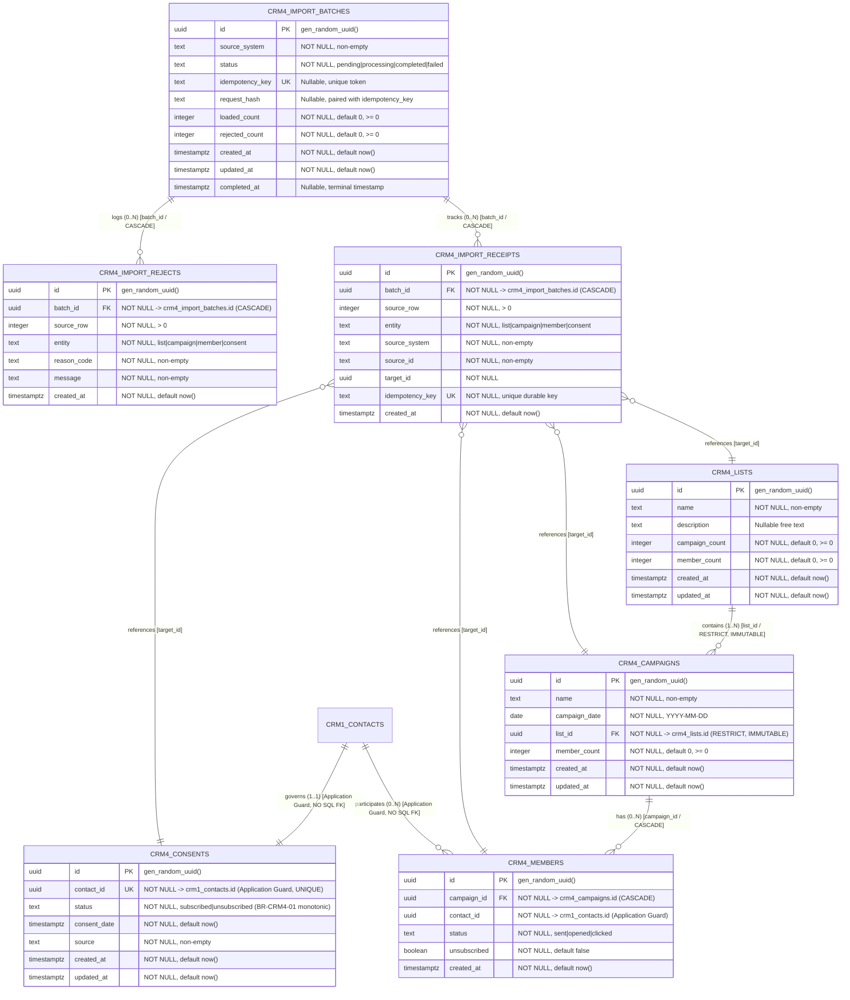

# ClearShift CRM — Entity-Relationship Diagram & Master-Data Ownership: CRM-4

**Module ID:** `CRM-4`
**Module Name:** Marketing Lists and Campaign History
**Owning Team:** Team `crm-marketing` (Group 4 — Role 4 Data / QA Lead)
**Schema Version:** 1.0.0
**Storage Engine:** PostgreSQL 18.6 with Drizzle ORM
**Target Milestone:** Gate G1 — Design Complete (Sprint 1)
**Traceability:** ClearShift Project Plan v3.0 §§9.3–9.6, 17; SDS ClearShift CRM v2.0 §4.5, §4.7; Master Architecture Baseline 1.0-A §4.2; Issue #177 `[CRM4-24]`.

---

## 1. Visual Entity-Relationship Diagram (Mermaid)

---

## 2. Cardinality & Relational Catalog

| Relationship ID | Source Entity | Source Column | Target Entity | Target Column | Cardinality | Delete Action | Enforcement Mechanism | Architectural Rules & Invariants |
| :--- | :--- | :--- | :--- | :--- | :---: | :---: | :--- | :--- |
| `REL-CRM4-01` | `crm4_campaigns` | `list_id` | `crm4_lists` | `id` | **N:1** | `RESTRICT` | Database Foreign Key | **List Immutability:** Once a campaign is created, `list_id` cannot be modified or reassigned. Deleting a list with campaigns is RESTRICTED. |
| `REL-CRM4-02` | `crm4_members` | `campaign_id` | `crm4_campaigns` | `id` | **N:1** | `CASCADE` | Database Foreign Key | Participant history rows cascade on parent campaign deletion. |
| `REL-CRM4-03` | `crm4_members` | `contact_id` | `crm1_contacts` | `id` | **N:1** | `RESTRICT` | Domain Application Guard | Cross-module reference to CRM-1 contacts. No direct SQL foreign key across schema boundaries (PLT-03). |
| `REL-CRM4-04` | `crm4_consents` | `contact_id` | `crm1_contacts` | `id` | **1:1** | `RESTRICT` | Domain Application Guard | Exactly one current consent record per contact. Enforces `BR-CRM4-01` monotonic opt-out invariant. |
| `REL-CRM4-05` | `crm4_import_receipts` | `batch_id` | `crm4_import_batches` | `id` | **N:1** | `CASCADE` | Database Foreign Key | Durable receipts committed in transaction with target entity rows; cascade on batch purge. |
| `REL-CRM4-06` | `crm4_import_rejects` | `batch_id` | `crm4_import_batches` | `id` | **N:1** | `CASCADE` | Database Foreign Key | Detailed rejection ledger rows cascade on batch purge. |
| `REL-CRM4-07` | `crm4_import_receipts` | `target_id` | `Target Entities` | `id` | **N:1** | `CASCADE` | Domain Application Guard | Polymorphic mapping from durable import receipts to the loaded target entity row. |

---

## 3. Master-Data Ownership & Cross-Module Boundaries (PLT-03)

1. **CRM-1 Contacts Master-Data Isolation:**
   - CRM-4 stores and manages **marketing lists, campaign engagement history, and contact consent state**.
   - Contact records (`first_name`, `last_name`, `email`, `phone`, `company_id`) are exclusively owned by module **CRM-1**.
   - Foreign keys to `crm1_contacts` are intentionally **omitted** at the PostgreSQL DDL layer to prevent cross-module coupling. Integrity is guaranteed via the CRM-1 Public Reference Resolver API (`assertContactExists`).

2. **Cross-Module Consent Projection:**
   - Modules CRM-1, CRM-2, CRM-3, and CRM-5 never read or mutate `crm4_consents` directly via SQL.
   - All modules consume the CRM-4 Public Reference Resolver (`crm4Resolver.getConsentStatus(contactId)`) or HTTP GET `/api/v1/crm-marketing/consents/:contact`.
   - The UI surfaces the `unsubscribed` status badge in contact overview screens as required by `FR-CRM4-05`.

3. **Atomic Transactional Invariant (KIT-08):**
   - During migration loads, target rows and their corresponding `crm4_import_receipts` are committed together in a single PostgreSQL transaction.
   - If either write fails, the entire transaction rolls back cleanly, and a rejection row is written to `crm4_import_rejects`.
