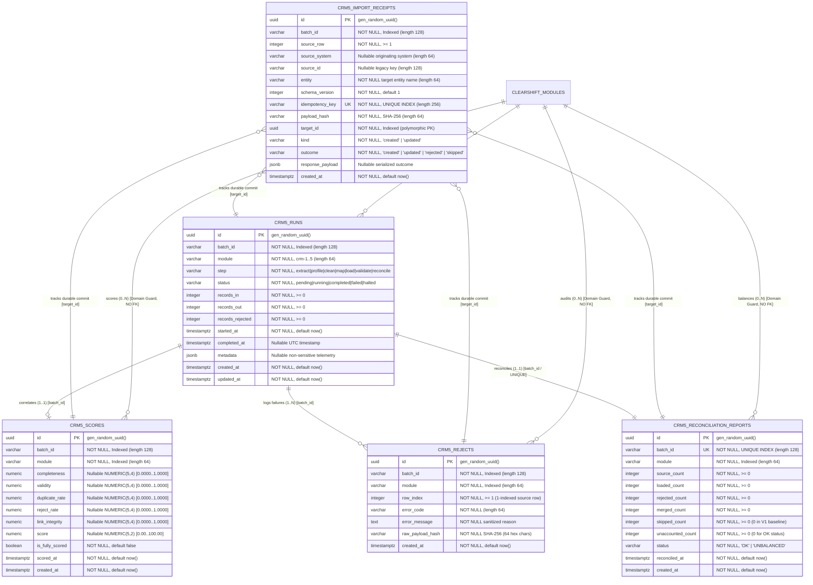

# ClearShift CRM — Entity-Relationship Diagram & Master-Data Ownership: CRM-5

**Module ID:** `CRM-5`
**Module Name:** Migration Control Center and Reports
**Owning Team:** Team `crm-reports` (Group 5 — Role 4 Data / QA Lead)
**Schema Version:** 1.0.0
**Storage Engine:** PostgreSQL 18.6 with Drizzle ORM
**Target Milestone:** Gate G1 — Design Complete (Weeks 1–2)
**Traceability:** ClearShift Project Plan v3.0 §§9.3–9.6, 17; SDS ClearShift CRM v2.0 §4.2, §4.7, §4.8, §4.11, §4.12; Master Architecture Baseline 1.0-A §4.2; Issue #197 `[CRM5-24]`.

---

## 1. Visual Entity-Relationship Diagram (Mermaid)

---

## 2. Cardinality & Relationship Catalog

| Relationship ID | Originating Entity | Target Entity | Foreign Key / Correlation | Cardinality | Deletion Policy | Enforcement Mechanism |
| :--- | :--- | :--- | :--- | :---: | :---: | :--- |
| `REL-CRM5-01` | `crm5_runs` | `crm5_scores` | `batch_id` | `1:1` | N/A | Logical Event Correlation |
| `REL-CRM5-02` | `crm5_runs` | `crm5_rejects` | `batch_id` | `1:N` | N/A | Logical Event Correlation |
| `REL-CRM5-03` | `crm5_runs` | `crm5_reconciliation_reports` | `batch_id` | `1:1` (Unique) | N/A | Logical Event Correlation & Unique Index |
| `REL-CRM5-04` | `crm5_import_receipts` | `crm5_runs` | `target_id -> crm5_runs.id` | `N:1` | N/A | Polymorphic Foreign Reference |
| `REL-CRM5-05` | `crm5_import_receipts` | `crm5_scores` | `target_id -> crm5_scores.id` | `N:1` | N/A | Polymorphic Foreign Reference |
| `REL-CRM5-06` | `crm5_runs` | `clearshift_modules` | `module` | `N:1` | RESTRICT | Domain Application Guard (Allowlist) |

---

## 3. Master-Data Ownership & Non-Negotiable Boundaries (PLT-03)

### 3.1 Strict Read-Only Projection Boundary
1. **Zero External SQL Mutations:** CRM-5 code never executes `INSERT`, `UPDATE`, or `DELETE` statements against tables owned by `crm-1`, `crm-2`, `crm-3`, `crm-4`, or platform schemas.
2. **Event-Driven Ingestion:** All cross-module data consumed by CRM-5 enters exclusively through approved outbox event streams (`RUN_PROJECTED`, `SCORE_COMPUTED`, `REJECT_RECORDED`, `RECONCILIATION_COMPLETED`) or in-process adapter calls.
3. **No Direct Table Joins:** Cross-module telemetry does not use SQL foreign keys or cross-schema joins. References to external entities degrade gracefully to display identifiers (e.g. `contact_id`, `deal_id`, `ticket_id`).

### 3.2 Caller Privilege & In-Process Target Adapter Boundary (Decision C4 & KIT-08)
1. **Zero Direct Caller Writes:** The Migration Kit never writes directly to CRM-5 private tables (`crm5_runs`, `crm5_scores`, `crm5_rejects`, `crm5_reconciliation_reports`, `crm5_import_receipts`).
2. **Atomic Single Transaction:** Ingested rows and durable receipts commit together in a single PostgreSQL transaction. A failure in either causes a complete rollback.
3. **Idempotency Deduplication:** The unique `idempotencyKey` (`batch ID + source row + target entity/schema version`) prevents duplicate writes during network retries or event redelivery.

---

## 4. Gate G1 Architecture Sign-off Block

* **Change Record ID:** `CR-CRM5-G1-002`
* **Milestone:** Gate G1 — Design Complete (Sprint 1)
* **Date Approved:** 2026-10-23
* **Approval Authority:** Group 5 Role 4 (Data / QA Lead) & Role 2 (Integration / Backend Engineer)
* **Status:** Verified, Signed Off, and Enforced in CI
