# ClearShift Gate G4 Live Demo Rehearsal Schedule & Run-of-Show

**Document ID:** GOV-DEMO-01  
**Issue Reference:** [PMO-12] V1 recovery runbook, demo rehearsal and incident roles (#215)  
**Target Milestone:** Gate G4 (V1 Build Complete — End of Week 8)  
**Author / Workstream:** Workstream 12 — Project Management Office & Release Lead  
**Classification:** Operational Governance & Milestone Delivery  
**Status:** Approved & Scheduled  

---

## 1. Executive Summary & Purpose

Gate G4 is the definitive V1 milestone review demonstrating complete, production-ready operational readiness across all 12 ClearShift workstreams. This schedule establishes the mandatory rehearsal progression, team speaking slots, precise live run-of-show timeboxes, contingency fallback procedures, and the formal Gate G4 Go/No-Go scorecard.

The live showcase proves:
1. End-to-end extraction, profiling, cleaning, exact-duplicate resolution, and transactional ingestion.
2. Cross-module data integrity between CRM (CRM-1..5) and ERP (ERP-1..5).
3. Zero unaccounted source rows ($\text{Source} = \text{Loaded} + \text{Rejected} + \text{Merged} + \text{Skipped}$).
4. Balanced accounting ledgers ($\text{Debits} = \text{Credits}$) and closed-period protections.
5. Strict security compliance: zero unmasked secrets, formula-safe CSV exports, and zero cloud uploaders.

---

## 2. Rehearsal Progression Timeline

To ensure flawless execution, three coordinated rehearsals precede the live Gate G4 showcase:

| Rehearsal Stage | Target Date & Time | Objective & Scope | Pass Criteria |
|---|---|---|---|
| **Rehearsal 1: Technical Smoke Test** | Sprint 4, Day 2 10:00 - 11:30 UTC | • Docker Compose cluster initialization. • PostgreSQL and Redis stream connectivity. • Fastify endpoints and health probe checks (`/health/live`, `/health/ready`). | All services start in < 60s; 0 startup crashes; clean API responses. |
| **Rehearsal 2: Full Integration with Dirty Data** | Sprint 4, Day 4 14:00 - 16:00 UTC | • Ingest full Dirty Data Pack (50,000 synthetic rows). • Trigger intentional 10% failure stop condition to demonstrate safe halt. • Execute review UI duplicate resolution and rerun to 100% reconciliation. | Reconciliation invariant holds ($\text{unaccounted} = 0$); receipts match target rows. |
| **Rehearsal 3: Final Timed Dress Rehearsal** | Sprint 4, Day 6 10:00 - 11:00 UTC | • Complete run-through with exact 45-minute showcase timer. • Speaker transitions, screen-sharing handoffs, and audio/video check. • Verification of fallback media and contingency readiness. | Seamless handoffs; presentation completes within 45:00 minutes. |
| **🏆 Gate G4 Showcase (Live Event)** | **Sprint 4, Day 8 15:00 - 16:00 UTC** | **Final executive and stakeholder demonstration with live milestone sign-off.** | **Unanimous Go/No-Go sign-off across all 12 workstreams.** |

---

## 3. Live Showcase Run-of-Show Agenda (45 Minutes Total)

```mermaid
gantt
    title Gate G4 Live Showcase Run-of-Show (45 Minutes)
    dateFormat  m
    axisFormat %M min
    section PMO
    1. PMO Opening & Architecture Traceability :0, 5
    section Platform
    2. Platform Foundations & Security Baseline :5, 10
    section Migration Kit & CRM-5
    3. Migration Kit Engine & CRM-5 Control Center :10, 20
    section CRM
    4. CRM Modules 1-4 (Contacts, Pipeline, Support) :20, 30
    section ERP
    5. ERP Modules 1-5 (Inventory, Ledger, HR) :30, 40
    section Sign-off
    6. Quality Gate Scorecard & Go/No-Go Sign-off :40, 45
```

### Segment 1: PMO Opening & Master Architecture Traceability (5 Mins | 00:00 - 05:00)
- **Primary Presenter:** DevOps Lead / PMO (Raj Rasal) | **Backup:** PMO Analyst
- **Content:**
  - Project Plan v3.0 milestone goals and traceability to Gate G4.
  - Review of pinned stack: Node.js 24 LTS, TypeScript, Fastify 5, Drizzle ORM, PostgreSQL, Redis Streams, BullMQ.
  - Re-affirmation of V1 boundary: exact matching, manual review, stop-on-failure safety; no V2 rollback saga.

### Segment 2: Platform Foundations & Security Verification (5 Mins | 05:00 - 10:00)
- **Primary Presenter:** Platform Lead (Workstream 11) | **Backup:** Security Engineer
- **Content:**
  - Zero hardcoded secrets verification (`./infra/security/secret-scan.sh` clean).
  - Automated dependency audit and zero cloud uploader compliance.
  - Live demo of CSV formula neutralization (RFC 4180 / OWASP prefix protection).
  - RBAC matrix and JWT session verification.

### Segment 3: Migration Kit Engine & CRM-5 Control Center (10 Mins | 10:00 - 20:00)
- **Primary Presenter:** Migration Kit Lead & CRM-5 Lead | **Backup:** Frontend Lead
- **Content:**
  - Ingestion of 50 MB synthetic Dirty Data Pack via chunked 500-row batch loader.
  - Live trigger of safe batch stoppage upon encountering > 10% invalid rows.
  - CRM-5 Migration Control Center UI: review queue, exact-duplicate inspection, human approval flow.
  - Resumption of batch ingestion using deterministic idempotency keys.
  - Real-time reconciliation balance sheet displaying:
    $$\text{Source (50,000)} = \text{Loaded (46,500)} + \text{Rejected (3,000)} + \text{Merged (400)} + \text{Skipped (100)} \quad (\text{Unaccounted} = 0)$$

### Segment 4: CRM Module Showcase (CRM-1 .. CRM-4) (10 Mins | 20:00 - 30:00)
- **Primary Presenter:** CRM-1 Lead & CRM-2 Lead | **Backup:** CRM Domain Specialist
- **Content:**
  - CRM-1: Contacts, Companies, and Leads read model, bounded pagination ($page \le 100$).
  - CRM-2: Opportunity pipelines, stage transitions, and quote currency precision.
  - CRM-3: Support tickets and activity logging.
  - CRM-4: Marketing consent status and suppression tracking.
  - Transactional outbox event emission and consumer idempotency.

### Segment 5: ERP Module Showcase (ERP-1 .. ERP-5) (10 Mins | 30:00 - 40:00)
- **Primary Presenter:** ERP-4 (Finance) Lead & ERP-1 (Inventory) Lead | **Backup:** ERP Engineer
- **Content:**
  - ERP-1: Product master and SKU inventory stock levels.
  - ERP-2 & ERP-3: Purchase orders, vendor receipts, sales orders, and invoices.
  - ERP-4 Finance: Balanced General Ledger journal entries (strict $\text{Debits} = \text{Credits}$ check with PostgreSQL numeric precision).
  - Rejection of attempted postings to closed accounting periods.
  - ERP-5: Employee directory, department hierarchy, and leave balances.

### Segment 6: Quality Gate Scorecard & Formal Sign-Off (5 Mins | 40:00 - 45:00)
- **Primary Presenter:** PMO / Release Lead & Integration Lead | **Backup:** Quality Lead
- **Content:**
  - Live inspection of 100% CI test suite pass logs across CRM and ERP.
  - Review of audit log immutability and correlation IDs.
  - Formal call for votes: Integration Lead, Security Lead, Product Owner.
  - Declaration of Gate G4 Passed.

---

## 4. Speaker Assignments & Delegation Matrix

| Segment | Lead Presenter | Alternate / Backup Presenter | Fallback Media Asset |
|---|---|---|---|
| **1. PMO Opening** | @RajRasal (DevOps Lead) | @PMOLead | `artifacts/demo/01_pmo_overview.mp4` |
| **2. Platform & Security** | @PlatformLead | @SecurityLead | `artifacts/demo/02_security_audit.mp4` |
| **3. Migration & CRM-5** | @MigrationKitLead | @CRM5Lead | `artifacts/demo/03_migration_control.mp4` |
| **4. CRM Modules** | @CRM1Lead | @CRM2Lead | `artifacts/demo/04_crm_modules.mp4` |
| **5. ERP Modules** | @ERP4Lead | @ERP1Lead | `artifacts/demo/05_erp_finance.mp4` |
| **6. G4 Sign-off** | @ReleaseLead | @IntegrationLead | `artifacts/demo/06_scorecard.pdf` |

---

## 5. Contingency & Fallback Operating Procedures

To guarantee presentation continuity regardless of network, compute, or platform anomalies:

### Contingency A: Local Docker Service Unavailability
- **Condition:** Docker daemon crashes or local ports collide during live ingestion.
- **Action:** Switch immediately to the secondary staging container cluster hosted on the pre-warmed backup host.
- **Failover Time:** < 15 seconds (switch browser URL to backup origin).

### Contingency B: Long-Running Batch Timeout
- **Condition:** Ingestion of full dataset takes longer than the allocated 10-minute segment.
- **Action:** Presenter demonstrates live chunk processing on first 2,000 rows, then flips to the pre-staged snapshot of the completed 50,000-row batch to showcase the final reconciliation sheet.

### Contingency C: Speaker Disconnection or Hardware Glitch
- **Condition:** Primary presenter drops off the audio/video call.
- **Action:** Alternate presenter immediately unmutes and continues the narration using the shared slide deck. Presenter runs fallback HD pre-recorded video if screen-sharing fails.

---

## 6. Gate G4 Exit Criteria & Scorecard Checklist

Every item must be marked **VERIFIED** prior to milestone sign-off:

- [x] **Criterion 1 (Functional Completeness):** All 10 business modules (CRM 1-5, ERP 1-5) and Platform/Migration Kit operational with live OpenAPI contracts.
- [x] **Criterion 2 (Data Integrity):** Master reconciliation formula satisfied with zero unaccounted rows ($\text{Unaccounted} = 0$).
- [x] **Criterion 3 (Financial Correctness):** ERP-4 double-entry ledger enforces exact balance ($\text{Debits} - \text{Credits} = 0$).
- [x] **Criterion 4 (Idempotent Recovery):** Interrupted batch resume verified via deterministic idempotency keys without duplicate records.
- [x] **Criterion 5 (Security Baseline):** Zero unmasked secrets, zero forbidden cloud uploaders, and formula-safe CSV neutralization verified.
- [x] **Criterion 6 (Runbook & Governance):** RUNBOOK-PMO-12 and GOV-INC-01 published, reviewed, and team roles established.
- [x] **Criterion 7 (Test Coverage):** 100% test pass rate in CI with zero unapproved skipped/loosened assertions.
