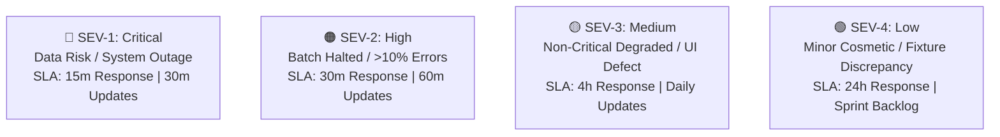
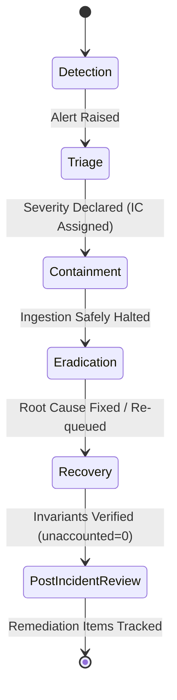

# ClearShift Incident Response Roles & Escalation Hierarchy

**Document ID:** GOV-INC-01  
**Issue Reference:** [PMO-12] V1 recovery runbook, demo rehearsal and incident roles (#215)  
**Target Milestone:** Gate G4 (V1 Build Complete)  
**Author / Workstream:** Workstream 12 — Project Management Office & DevOps Lead  
**Classification:** Incident Response Governance & Operational Hierarchy  
**Status:** Approved & Enforced  

---

## 1. Executive Summary & Objective

This document defines the authoritative incident response hierarchy, roles, communication protocols, and escalation pathways for ClearShift V1. During live migrations, dry runs, and Gate G4 operations, unambiguous ownership and rapid response structures are essential to protect data integrity, prevent cascading system failures, and maintain transparent stakeholder communication.

---

## 2. Incident Response Role Matrix

During any declared operational incident (SEV-1 through SEV-3), the following command structure is activated:

| Role Title | Primary Assignee / Workstream | Core Responsibilities |
|---|---|---|
| **Incident Commander (IC)** | DevOps Lead / Workstream 12 (PMO) | • Assumes single command authority of incident response.<br>• Directs investigation, triage, and mitigation actions.<br>• Declares incident severity level and calls incident stand-down.<br>• Ensures compliance with V1 non-negotiable boundaries (no unapproved rollback sagas). |
| **Communications Lead (CL)** | PMO Lead / Project Manager | • Owns all communications to executive stakeholders and partner teams.<br>• Drafts 30-minute status broadcasts for SEV-1 and 60-minute updates for SEV-2.<br>• Shielding engineering teams from external interruption.<br>• Maintains the live incident timeline and communication log. |
| **Platform / Infra Lead** | Platform Lead / Workstream 11 | • Owns shared infrastructure: PostgreSQL, Redis Streams, BullMQ, Auth/JWT, and Node runtime.<br>• Diagnoses connection pool exhaustion, broker latency, outbox relays, and memory pressure.<br>• Coordinates node restarts and network partitioning recovery. |
| **CRM Technical Lead** | CRM Domain Leads (CRM-1 .. CRM-5) | • Leads root cause diagnosis for CRM domain mutations, entity validation, and duplicate policies.<br>• Verifies contacts, companies, leads, deals, and control center read models.<br>• Approves domain-specific patch or quarantine procedures. |
| **ERP Technical Lead** | ERP Domain Leads (ERP-1 .. ERP-5) | • Leads diagnosis for ERP domain mutations, inventory, purchasing, orders, and accounting.<br>• Guarantees balanced general ledger entries (debits = credits) and fiscal period posting rules.<br>• Approves ERP-side recovery and idempotency reconciliations. |
| **Integration & QA Lead** | Integration / QA Lead (Workstream 12) | • Verifies reconciliation mathematical invariants (`unaccounted = 0`).<br>• Validates dirty-data pack test fixtures and reproduces defects in isolated test harness.<br>• Conducts post-recovery verification before declaring normal operations restored. |

---

## 3. Severity Classification Matrix

Incidents are classified into four severity tiers based on business impact, data risk, and migration blast radius:



| Severity Tier | Definition & Criteria | Target Response SLA | Status Broadcast Cadence | Escalation Path |
|---|---|---|---|---|
| **SEV-1 (Critical)** | • Accounting imbalance (debits != credits).<br>• Data loss or corrupt receipts.<br>• Complete pipeline / API outage.<br>• Security compromise or credential leak.<br>• `unaccounted > 0` after batch run. | **< 15 minutes** | **Every 30 minutes** | Page IC, Platform Lead, Domain Tech Leads, and Executive Sponsors immediately. |
| **SEV-2 (High)** | • Migration batch halted due to > 10% row failure threshold.<br>• Core module API endpoint failing (HTTP 500).<br>• Outbox relay backlog > 5,000 unacknowledged events.<br>• Database connection timeouts > 5,000 ms. | **< 30 minutes** | **Every 60 minutes** | Page IC and relevant Module Lead. Escalate to SEV-1 if uncontained within 2 hours. |
| **SEV-3 (Medium)** | • Transient Redis worker lag recoverable within retry budget.<br>• Review UI display flaw in CRM-5 dashboard.<br>• Non-blocking validation anomaly affecting < 1% of rows.<br>• Synthetic fixture parsing warning. | **< 4 hours** | **Daily status summary** | Assigned to module sprint backlog; addressed in current sprint. |
| **SEV-4 (Low)** | • Minor documentation typo.<br>• Style token discrepancy in non-critical screen.<br>• Informational log formatting inconsistency. | **< 24 hours** | **Next sprint planning** | Logged as standard GitHub Issue with `P3` / `P4` priority. |

---

## 4. Incident Lifecycle & Escalation Pathway

The operational incident lifecycle progresses through six sequential phases:



### Phase 1: Detection
- Automated alerts from Prometheus/health probes (`/health/live`, `/health/ready`), BullMQ failure metrics, or manual operator reports.
- Telemetry captures correlation ID (`corr_id`), batch ID, and timestamp.

### Phase 2: Triage & Severity Declaration
- First responder notifies DevOps on-call.
- DevOps Lead assumes Incident Commander role, assesses blast radius against the Severity Matrix, and opens an incident war room.
- Communications Lead establishes public incident channel `#incident-sev-live`.

### Phase 3: Containment (Safe Stoppage)
- Execute **RUNBOOK-PMO-12 §3 (Safe Batch Stoppage)**:
  - Transition run to `HALTED` state.
  - Halt worker consumption without dropping in-flight transactional chunks.
  - Preserve all error rows in rejects table.
  - Ensure zero partial mutations exist outside transaction receipts.

### Phase 4: Eradication
- Domain leads isolate the failing source row, schema mismatch, or configuration defect.
- If bug requires code fix: create emergency hotfix branch (`fix/<issue>-<description>`), verify against test suite, and deploy via expedited review (minimum 2 approvals).

### Phase 5: Recovery & Verification
- Execute **RUNBOOK-PMO-12 §4 (Node Restart & Recovery)**:
  - Bring worker nodes online.
  - Resume ingestion using deterministic idempotency keys (`batch ID + source row + target entity/schema version`).
  - Run reconciliation validation script:
    $$\text{Source Rows} = \text{Loaded} + \text{Rejected} + \text{Merged} + \text{Skipped} \quad (\text{Unaccounted} = 0)$$

### Phase 6: Post-Incident Review (PIR)
- Convene a blameless post-mortem within 48 hours for SEV-1 and SEV-2 incidents.
- Publish post-mortem report and track corrective actions in GitHub with assigned owners and target completion dates.

---

## 5. Communication Protocol & Channels

1. **Internal Incident Channel:** `#incident-sev-live` (Slack / Discord / Teams).
2. **War Room Bridge:** Dedicated audio/video bridge opened by IC for all SEV-1 and SEV-2 incidents.
3. **Status Broadcast Template (Sent by Communications Lead):**
   ```markdown
   **[INCIDENT UPDATE] - SEV-1: Migration Batch Ingestion Halted**
   • Time: 2026-10-22 14:00 UTC
   • Incident Commander: @RajRasal (DevOps Lead)
   • Communications Lead: @PMOLead
   • Current Status: Containment Active — Ingestion halted at Chunk 12 (Row 6,000)
   • Impact: CRM-1 Contacts Ingestion paused; zero data corrupted; receipts intact.
   • Next Actions: Investigating schema validation mismatch on phone format.
   • Next Update: In 30 minutes (14:30 UTC).
   ```

---

## 6. Blameless Post-Mortem Template

Every SEV-1 or SEV-2 incident must generate a post-mortem document stored under `docs/incident-reports/` using the following format:

```markdown
# Incident Post-Mortem: [INC-YYYY-MM-DD-01]

## 1. Summary
• Date & Duration: YYYY-MM-DD (XX minutes total downtime)
• Severity: SEV-X
• Incident Commander: [Name]
• Root Cause Category: [Schema Validation / DB Pool / Memory / Dependency]

## 2. Impact Analysis
• Total source rows affected: X
• Rows successfully loaded: X
• Rows safely quarantined in rejects: X
• Unaccounted rows: 0 (Verified invariant satisfied)
• Business downtime: XX minutes

## 3. Incident Timeline
• HH:MM - Alert triggered by error threshold monitor (> 10%).
• HH:MM - Ingestion safely halted; IC assumed command.
• HH:MM - Root cause identified in country code parser.
• HH:MM - Hotfix deployed and validated with synthetic fixture.
• HH:MM - Batch resumed with idempotency key; all rows accounted for.

## 4. Five Whys Root Cause Analysis
1. Why did the batch halt? -> Row failure rate reached 12%.
2. Why did row failures occur? -> Postal code normalization failed for UK format.
3. Why did normalization fail? -> Regex assumed 5-digit US ZIP format only.
4. Why was this not caught in unit tests? -> Fixture pack lacked UK address samples.
5. Why were UK samples missing? -> Dirty Data Pack v1 focused on North American leads.

## 5. Corrective Action Items
| Action Item | Owner | Target Date | Tracking Issue |
|---|---|---|---|
| Expand address normalizer regex to support UK/EU postcodes | CRM-1 Lead | Sprint 4 | #XXX |
| Add international dirty data fixtures to CI test suite | QA Lead | Sprint 4 | #XXX |
```
